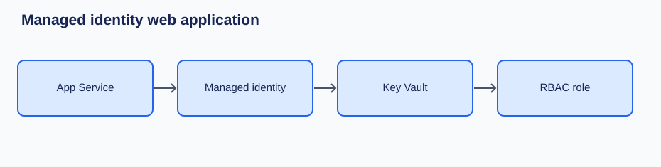

# Managed identity web application



**Pattern ID:** AZ-PAT-003  
**Scope:** Resource group  
**Purpose:** Reference implementation demonstrating managed identity web application.

## Deploy

```bash
az login
az account set --subscription '<SUBSCRIPTION_ID>'
az bicep lint --file patterns/03-secure-webapp/main.bicep
az group create -n rg-bicep-patterns-dev -l uksouth
az deployment group what-if -g rg-bicep-patterns-dev --parameters patterns/03-secure-webapp/dev.bicepparam
az deployment group create -g rg-bicep-patterns-dev --parameters patterns/03-secure-webapp/dev.bicepparam
```

## Design and security considerations

- This is a **learning/reference pattern**, not a production landing zone. Review SKU, access, region, cost and organisational policy before deploying.
- Apply least-privilege deployment permissions; never commit secrets or credentials.
- Run `what-if` and obtain approval before applying to shared environments.
- Test connectivity, RBAC, diagnostics and rollback in an isolated subscription first.
- The `.drawio` file is editable in diagrams.net; the `.svg` is a GitHub preview.

**Note:** Key Vault remains publicly reachable in this demo; production should add private networking and restrict ingress.
