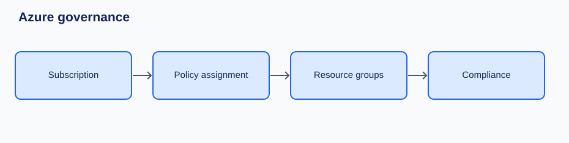

# Azure governance



**Pattern ID:** AZ-PAT-007  
**Scope:** Subscription  
**Purpose:** Reference implementation demonstrating azure governance.

## Deploy

```bash
az login
az account set --subscription '<SUBSCRIPTION_ID>'
az bicep lint --file patterns/07-policy-governance/main.bicep
az deployment sub what-if --location uksouth --parameters patterns/07-policy-governance/dev.bicepparam
az deployment sub create --location uksouth --parameters patterns/07-policy-governance/dev.bicepparam
```

## Design and security considerations

- This is a **learning/reference pattern**, not a production landing zone. Review SKU, access, region, cost and organisational policy before deploying.
- Apply least-privilege deployment permissions; never commit secrets or credentials.
- Run `what-if` and obtain approval before applying to shared environments.
- Test connectivity, RBAC, diagnostics and rollback in an isolated subscription first.
- The `.drawio` file is editable in diagrams.net; the `.svg` is a GitHub preview.

**Note:** This example uses a built-in policy definition ID; verify its availability and permissions in the target tenant before deployment. Policy may flag resources created without the tag.
